# Beam Designer v2.6 (Streamlit)

**SFD · BMD · Deflection · Load combinations · LTB · Auto section · 3D · Parametric · CSV · PDF report**

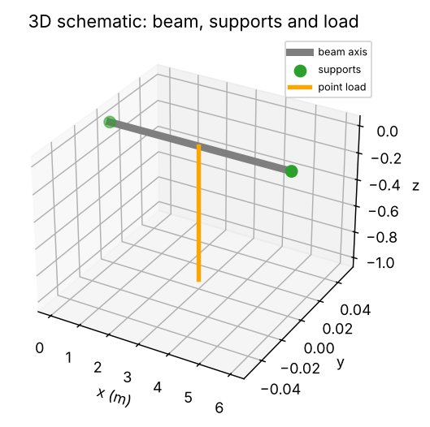

> **Flat repository:** every file lives in the root — no subfolders — so it can be uploaded straight from a phone.

## Architecture

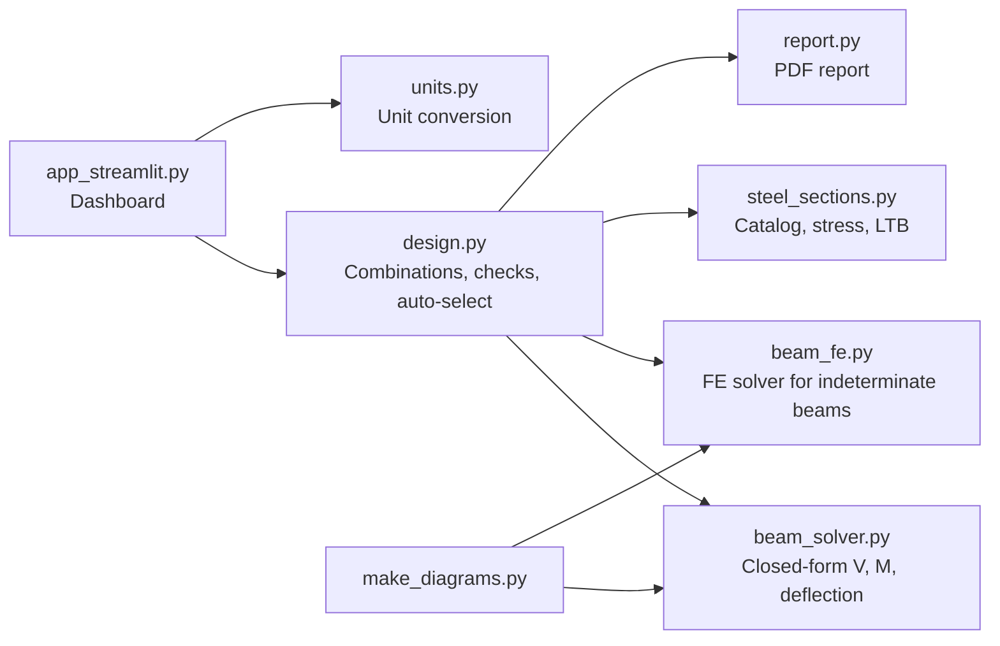

## Workflow

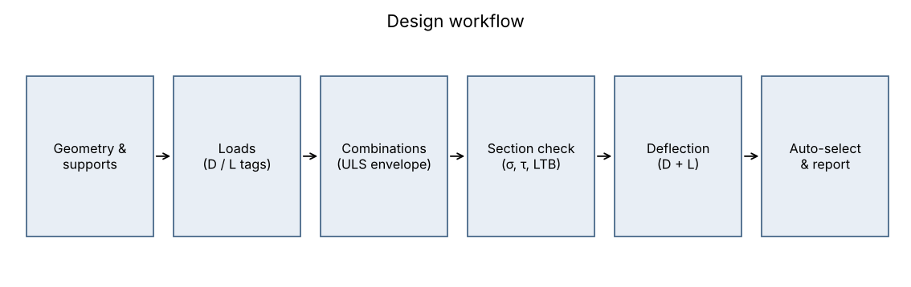

## What’s included

| Capability | Detail |
|------------|--------|
| Supports | Simply supported, cantilever, overhang, propped cantilever, fixed–fixed, **two-span continuous** (any number of supports via FE) |
| Loads | Point, UDL, UVL/trapezoid, point moment |
| **Load cases** | Each load tagged Dead (D) or Live (L); self-weight added automatically |
| **Load combinations** | Editable factor table; strength uses the envelope, δ uses D + L |
| **LTB** | Lateral-torsional buckling check (simplified IS 800-style, χ_LT) with unbraced length input |
| Diagrams | SFD, BMD, deflection, combined; all images regenerated by `make_diagrams.py` |
| **3D** | Axis + scaled δ, V–M path, I-section extrusion |
| Steel | ISMB/UB catalog, σ/τ check, utilisation |
| Auto-select | Lightest section passing **strength, LTB and deflection** |
| Serviceability | L/250 … L/500 |
| Parametric | UDL sweep charts |
| Units | kN or N, m or mm (deflection always mm, stress MPa) |
| Redistribution | Up to 30 % moment redistribution at interior supports (continuous beams) |
| Export | CSV (V,M,y), JSON summary, **PDF design report** |

## Quick start

```bash
pip install -r requirements.txt
streamlit run app_streamlit.py
pytest -v
python make_diagrams.py   # optional: regenerate all diagrams
```

CI (`ci.yml` — move it to `.github/workflows/ci.yml` to enable GitHub Actions) runs `ruff check` and the test suite on every push.

## Changelog

### v2.6
- **Continuous beams with point loads:** verified against three-moment results (support moment −3PL/32, centre reaction 11P/16, far reaction −3P/32 uplift). Every design result now reports an equilibrium check (sum of reactions minus applied load).
- **Moment redistribution:** up to 30 % of the interior hogging moment can be redistributed. Each span receives a linear correction whose ends are the support moment changes, so it carries no net load and equilibrium holds. Span moments increase, and the design envelope includes both. Section rotation capacity (Class 1/2) is not checked.
- **Unit selection:** force (kN or N) and length (m or mm) in the dashboard. Calculations stay in SI; inputs are converted on the way in and outputs on the way out. Deflections are shown in mm and stresses in MPa. The PDF report stays in SI.

### v2.5
- **Continuous beams:** the finite-element solver handles any number of supports. Added a two-span pin–roller–roller layout; verified against the closed-form two-span reactions and moments.
- **Lateral restraint sensitivity:** `ltb_sensitivity()` checks the selected section over a range of unbraced lengths. The dashboard shows the sweep as a chart and table, and the PDF report includes a short sensitivity table.
- **Steel comparison with LTB:** the comparison tab now shows buckling-inclusive bending utilisation and χ_LT for every section, not only plain bending.
- **Report:** adds a load-case table (every load with its D/L tag, plus self-weight) and the sensitivity table.

### v2.4
- **Indeterminate beams:** propped cantilever and fixed–fixed supports, solved with a Hermite-cubic finite-element model (`beam_fe.py`). Determinate beams still use the closed-form solver.
- **Fixes found while testing:** applied couple had the wrong sign in the new solver (corrected, and checked against the determinate solver); the Parametric tab and dashboard were checked against all five support layouts.
- **Verification:** finite-element results are checked against closed-form and exact-curve solutions (fixed–fixed, propped cantilever, point load on a propped cantilever). Buckling checks use independent limits (warping-free torsion formula, length dependence), not a published worked example.
- **Diagrams:** all images regenerated with `make_diagrams.py` (new: support comparison, LTB curve, load-case gallery).

### v2.3
- **Load cases and combinations:** loads tagged D or L, self-weight added automatically, editable factor table. Strength uses the envelope of factored combinations; deflection uses unfactored D + L.
- **Lateral-torsional buckling:** χ_LT check with an unbraced length input (default = span). Section warping and torsion constants are approximated from the I-section dimensions, so results are conservative and indicative only.
- **Design layer:** analysis moved out of the Streamlit script into `design.py`, so it is tested directly.
- **PDF design report:** downloadable from the dashboard.
- **Quality:** pinned dependencies, pytest config, ruff config, CI workflow.

### v2.2
- **Fix:** overhang bending moment was wrongly forced to zero at the right support; the diagram and deflection for overhang beams are now correct.
- **Fix:** bending moment is computed in closed form at each station. The previous integration left first-order error at point loads and supports (e.g. a free tip moment of several hundred N·m on a coarse grid).
- **Fix:** auto-select recomputed deflection with factored (ULS) loads; deflection now always uses service loads.
- **Change:** auto-select only returns a section that passes both strength and the deflection limit.
- **Fix:** the Parametric tab now uses the selected support layout (it previously ignored the overhang).
- **Tests:** added analytic checks for overhang moments, simply supported point-load deflection, cantilever UDL deflection, point-moment reactions, and the deflection-aware recommender.

## Diagram gallery

### Design workflow


### Load case gallery (SFD & BMD)
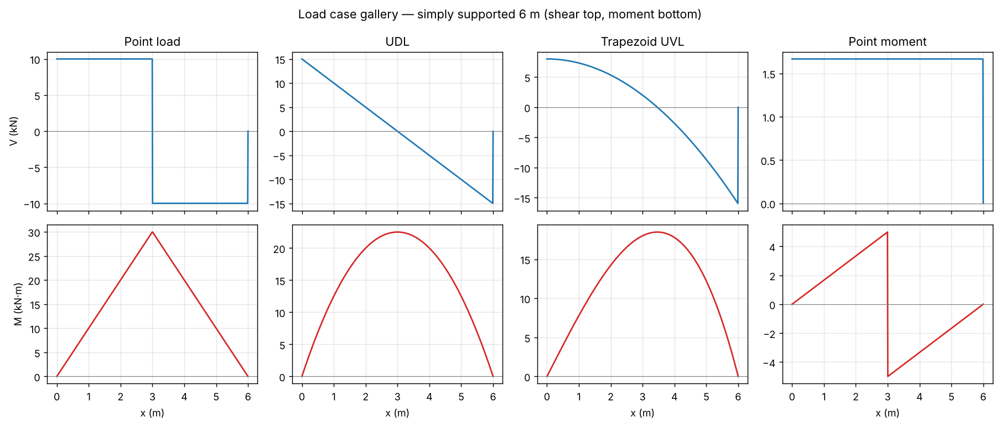

### Classic SFD / BMD / δ
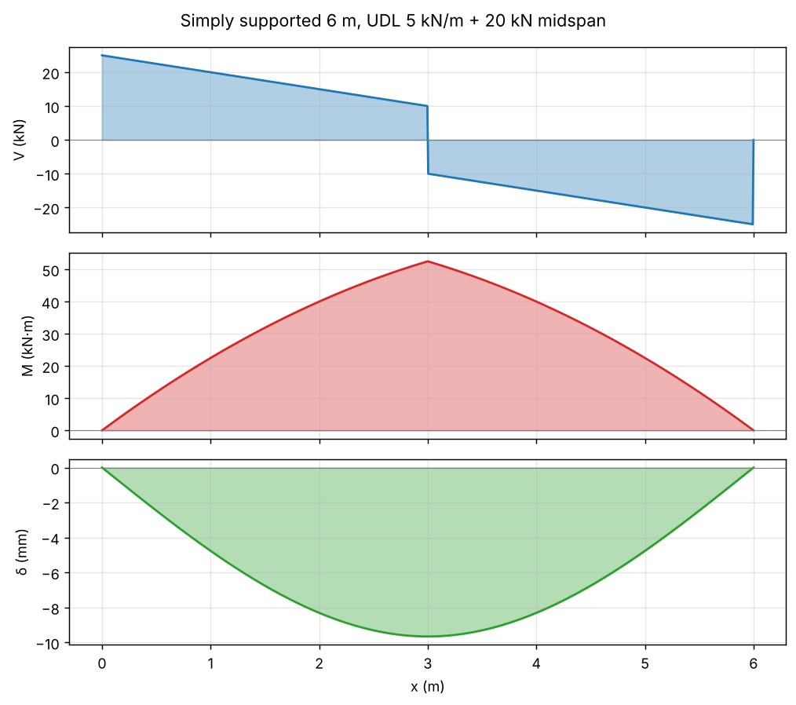

### Overhang
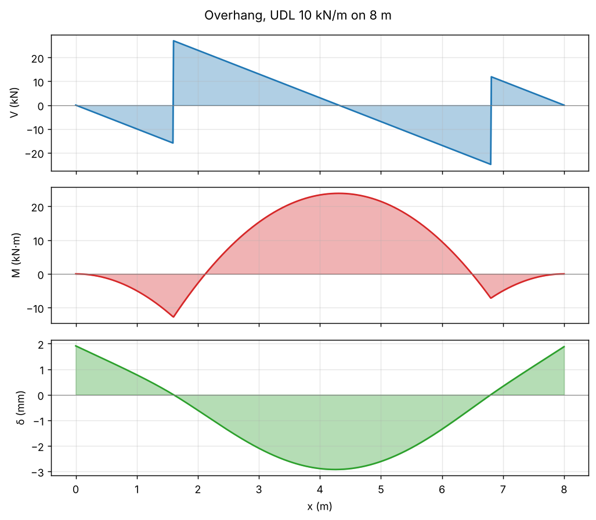

### Support-type comparison
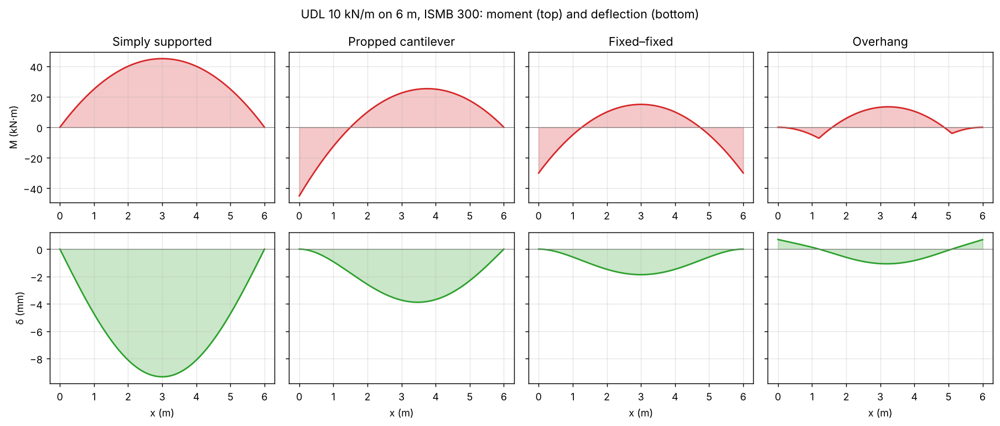

### Section comparison & utilisation
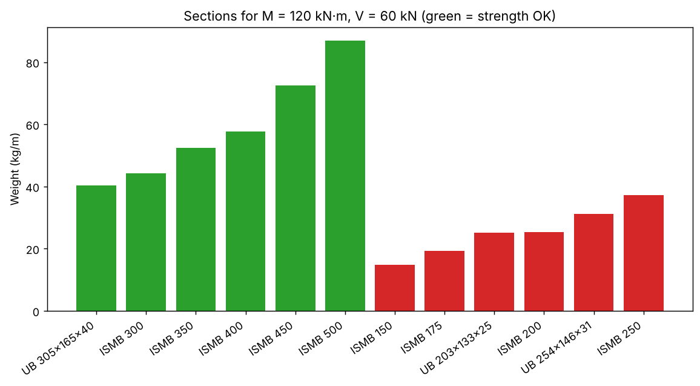
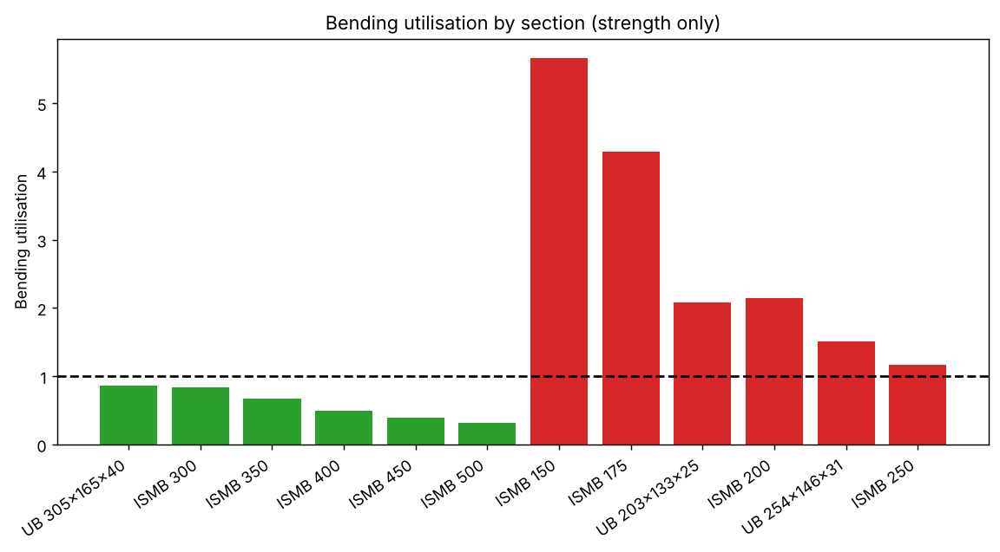
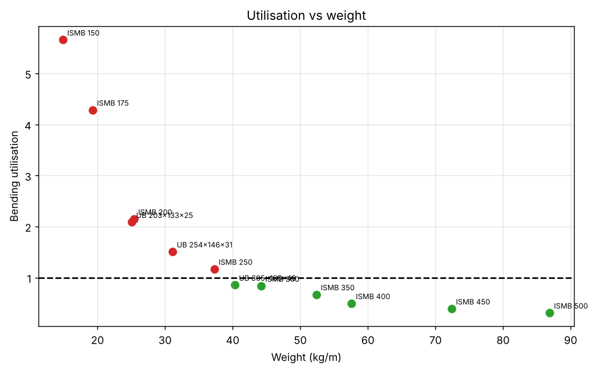

### Section capacity chart
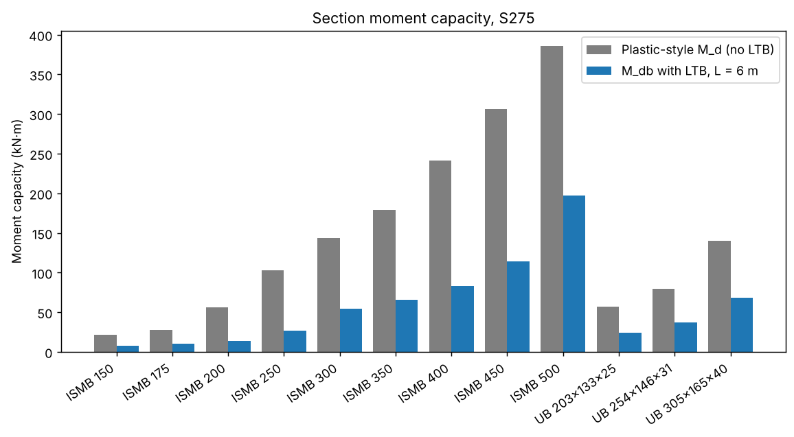

### Deflection by section
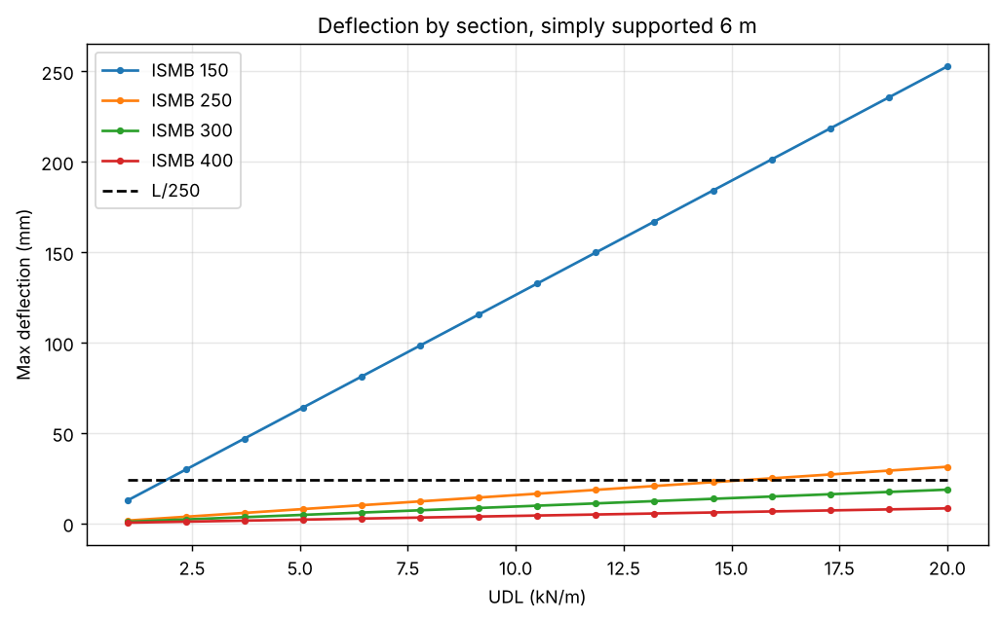

### Serviceability
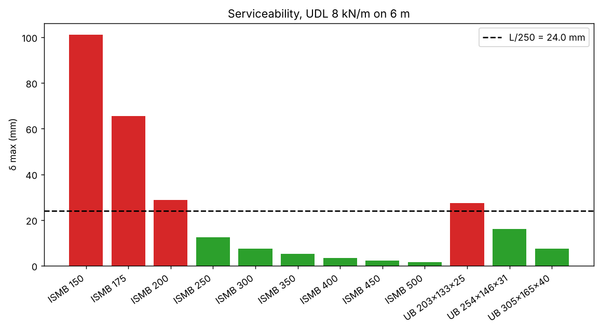

### Moment heatmap (L × w)
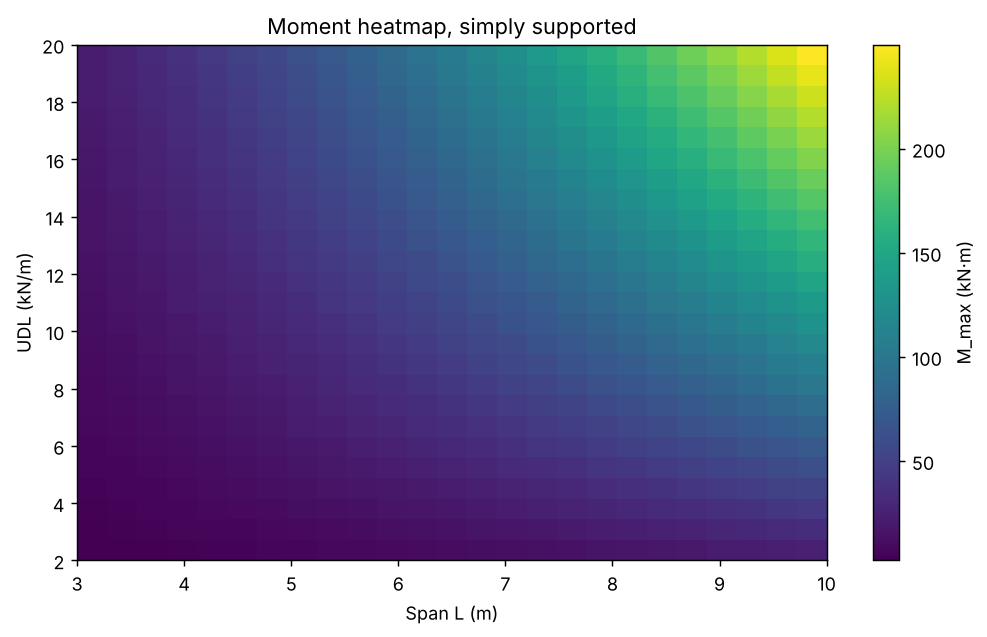

### Before / after auto-select
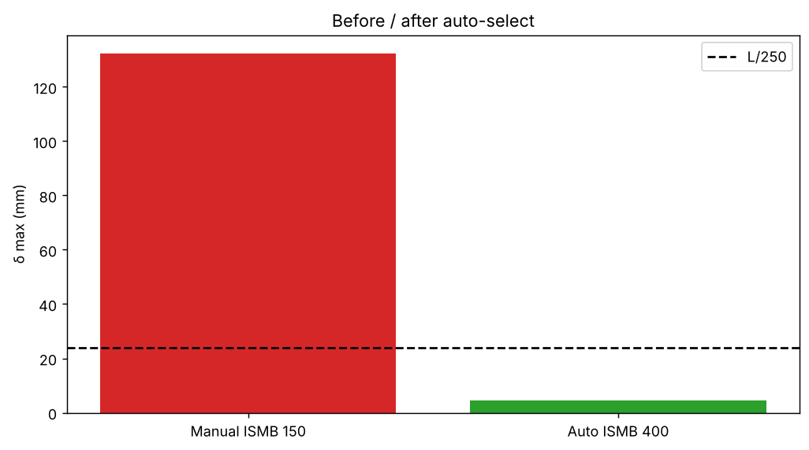

### 3D schematic


### Response vs UDL
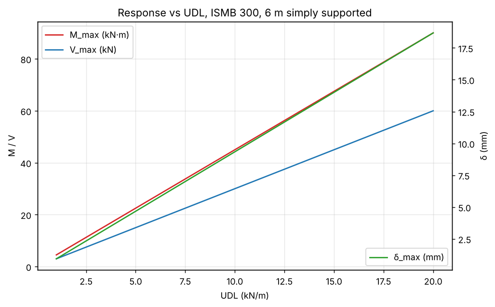

### Load schematic
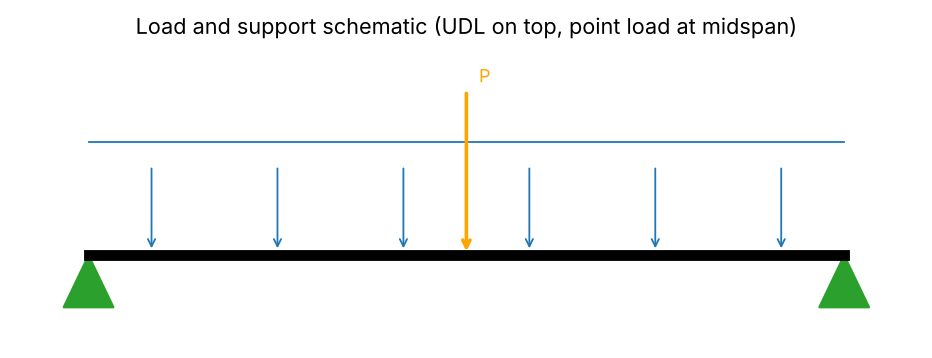

## Modules

| File | Role |
|------|------|
| `beam_solver.py` | V, M (closed form), δ, serviceability, load-case scaling, parametric |
| `steel_sections.py` | Catalog, stress checks, lateral-torsional buckling, recommend |
| `beam_fe.py` | Finite-element solver for indeterminate beams (propped, fixed–fixed) |
| `design.py` | Load combinations, section checks, auto-select, LTB sensitivity, load-case table (no UI code) |
| `report.py` | PDF design report (reportlab + matplotlib) |
| `app_streamlit.py` | Dashboard (thin layer over `design.py`) |
| `units.py` | Display-unit conversions (all calculations stay in SI) |
| `test_*.py` | 55 analytical, regression, finite-element, design, report and unit tests |
| `make_diagrams.py` | Regenerates every `.png` diagram in this folder from the solver |
| `ci.yml` | GitHub Actions workflow (ruff + tests) |

## Verification status

- Unit and analytical tests: `pytest` (55 tests).
- Finite-element results match closed-form beam solutions to within 0.1%.
- Continuous beams with point loads are checked against three-moment results. Redistribution is checked against the closed-form two-span result (span moment 0.075wL² after 20 % redistribution).
- Lateral-torsional buckling is checked against independent limits, **not** against a published IS 800 or AISC worked example. Validate against a handbook example before relying on the LTB numbers.
- The dashboard was executed end-to-end with a stub Streamlit/Plotly for all support layouts; it has not been run in a real Streamlit server.

## Notes

Educational portfolio tool. Simplified checks — not a full IS 800 / AISC design package. The LTB check uses approximate section properties and a plastic-to-elastic simplification, so it is conservative but not code-verified.

**Tags:** `beam-design` `sfd` `bmd` `steel` `streamlit` `mechanical-engineering`
